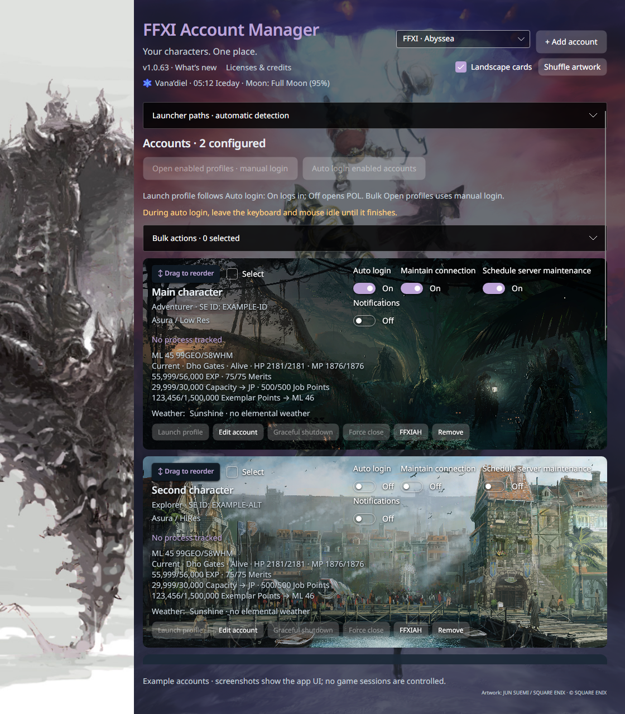
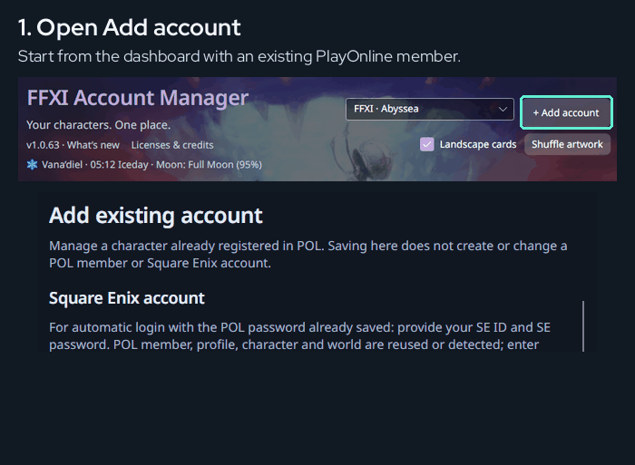
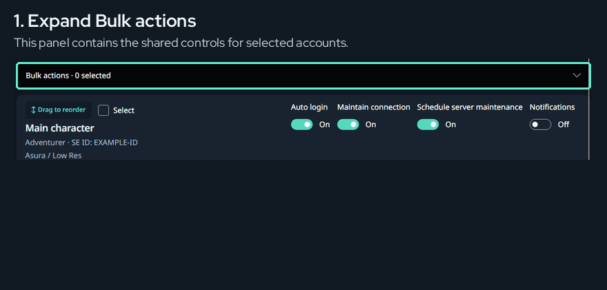
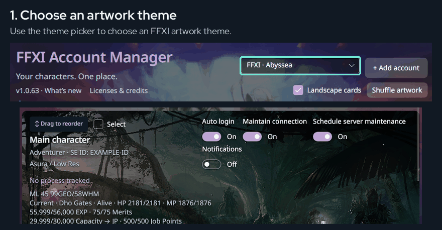

# FFXI Account Manager

Launch, monitor, and recover multiple Final Fantasy XI accounts from one Windows dashboard. Each account can use its own Windower profile, login settings, maintenance schedule, and alerts.

[Download for Windows x64](https://github.com/zipkindev/FFXIAccountManager/releases/latest) · [Release notes](CHANGELOG.md)

**App updates** checks the public releases page automatically. In 1.0.65 or newer, it shows the last and next checks and checks shortly after startup and every 12 hours while the manager stays open. You can install from the manager or turn on automatic installation when idle. Use the protected desktop shortcut from unattended setup to enable in-app installation. Running games stay open.

## Quick start

1. **Open the manager.** Run the standalone EXE, or extract the Windows ZIP and open `FFXILauncher.Desktop.exe`. You’ll need an existing Windower and FFXI installation, with a PlayOnline (POL) member already set up. The package includes .NET.
2. **Add an account.** Enter your Square Enix ID and password, select a Windower profile, and confirm the character and world. **Launcher paths** lets you override automatic detection and set up unattended access. Windows encrypts saved credentials for your user account. Use manual login for accounts that require a one-time password.
3. **Deploy the companion addon.** Choose **Deploy addon + enable auto-load**. In an existing game session, use `//lua load FFXIManager`, or `//lua reload FFXIManager` if you’re updating an already loaded addon. The companion reports connection and character status and handles graceful shutdown requests.
4. **Launch and verify.** Turn on **Auto login**, choose **Launch profile**, and leave the keyboard and mouse idle while the manager operates POL. Once the account has completed a verified login, enable **Maintain connection** and keep the manager open for automatic recovery.

GIF guide: Add an account and choose a Windower profile

[Account editor screenshot](docs/images/account-setup.png)

## Accounts and session controls

| Control | What it does |
| --- | --- |
| **Launch profile** | Opens the account’s Windower profile. With **Auto login** on, the manager completes the login. With it off, you sign in yourself. |
| **Open enabled profiles** or **Open selected profiles** | Opens several profiles for manual login. **Auto login enabled accounts** runs the automated login queue. Use **Stop auto logins** to stop an active queue. |
| **Discover sessions** | Attaches to already running games and matches them to accounts using the companion’s character and world reports. |
| **Bulk actions** | Select accounts and change their Auto login, Maintain connection, or maintenance scheduling settings together. You can also open selected profiles or request graceful shutdown. |
| **Graceful shutdown** | Asks the companion addon to log out and close a game. You can cancel pending shutdowns. **Force close** is available for a tracked session that needs to be closed immediately. |

GIF guide: Enable Maintain connection for multiple accounts

Open **Bulk actions**, select the accounts, choose **Enable maintain connection**, and select **Apply to selected**. This also enables **Auto login** and clears a saved recovery pause on the selected accounts. Use the individual **Select** boxes when only some accounts should change.

## Login, recovery, and updates

- **Verified login.** The manager identifies the configured POL member, checks masked password input, and verifies the expected character and world using the companion heartbeat and fresh server traffic. If focus or keyboard layout changes before password submission, it can discard the interrupted entry and retry once.
- **Maintain connection.** The manager checks for recognized disconnect screens after repeated unhealthy connection reports. It can resume from the exact configured member or character selection, or restart the affected client when a confirmed error prevents recovery. For in-game **POL-2059** behind a HaupBridge overlay, it verifies the error and visible **OK** control, then uses the game’s Enter key. An open Windower console or an unconfirmed transition can pause recovery.
- **Internet recovery precheck.** A successful connectivity check lets login proceed immediately. After an actual failed check, the manager waits for three successful checks five seconds apart; repeated failures back off up to 30 seconds. Accounts share checks without repeatedly taking focus. POL-0019 resumes its bounded Retry sequence after connectivity returns. Internet connectivity does not guarantee POL service availability.
- **Other-terminal protection.** A confirmed **POL-1039** disables automatic recovery for that account and shows the reason on its card. An intentional manual launch is available through **Launch anyway**.
- **Scheduled maintenance.** Official notices and in-game warnings appear in **Server maintenance**. Enable **Schedule server maintenance** per account to allow scheduled graceful shutdown. Maintained accounts can reconnect once the applicable maintenance ends. The card alert threshold controls how early notices appear on cards.
- **Shared game updates.** The first client takes ownership of a required update. Other launches wait while it updates and reconnects. The manager resumes through a recognized completion screen and keeps a stalled updater available for inspection or resumption.

[Recovery changes and validation by version](CHANGELOG.md)

## Character dashboard and appearance

- **Session status.** Cards show the tracked process, connection state, POL start time, session duration, and last successful automatic recovery. **Connected** means the manager has verified game traffic for that character. Older stats are labeled **Last reported**.
- **Character stats.** View job and master levels, current and maximum HP/MP, EXP, merits, capacity and job points, and Exemplar Point progress toward the next master level. The dashboard shows shared Vana’diel time and moon phase alongside each character’s zone and weather. Use **FFXIAH** on a card to look up that character.
- **Appearance.** Drag cards to reorder them. Choose a UI or FFXI artwork theme, toggle **Landscape cards**, or use **Shuffle artwork** to rotate the card backgrounds.

GIF guide: Change the theme and card layout

[Browse the theme gallery](docs/themes/README.md)

## Telegram notifications

Choose alerts for scheduled maintenance, in-game warnings, character death, failed recovery, capped points, and master level gains. Create alert profiles with different event choices and maintenance lead times, then enable notifications on the characters you want to monitor.

1. Create a bot with BotFather and send it `/start` or add it to your group.
2. In **Notifications**, enter the bot token. Use **Find chat ID** to select your chat, or enter the chat ID directly.
3. Enable Telegram delivery, select **Save Telegram**, and use **Send test** to verify delivery.
4. Save an alert profile and enable **Notifications** on the appropriate account cards. Keep the manager open for delivery.

[Notification settings screenshot](docs/images/notifications.png)

## Validation

Automated checks cover account identity, password-entry guards, connection recovery, update scheduling, OCR, installer rollback, and companion reports. Release notes distinguish live Windows validation from simulated outage and regression tests. This repository distributes documentation and Windows packages.

## License

Original code and documentation are MIT licensed. FINAL FANTASY XI artwork, icons, and trademarks remain subject to their owners’ terms. This is an independent project. [MIT license](LICENSE) · [Artwork notice](ARTWORK-NOTICE.md) · [Third-party notices](THIRD-PARTY-NOTICES.md)
